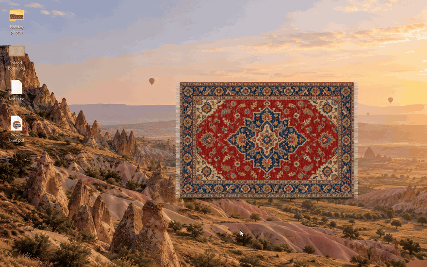
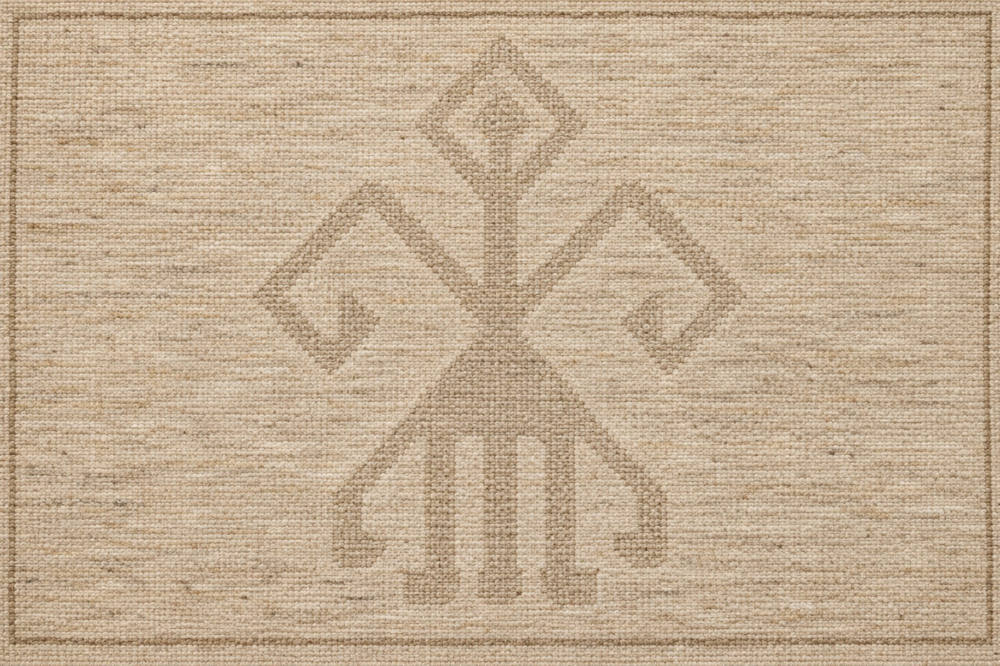
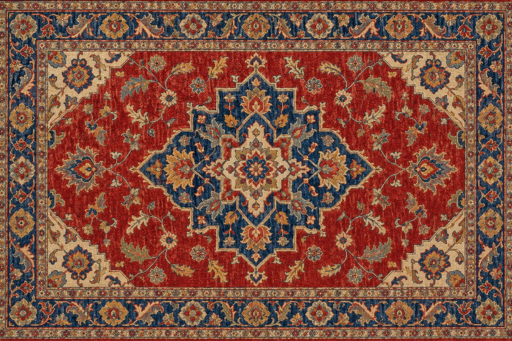
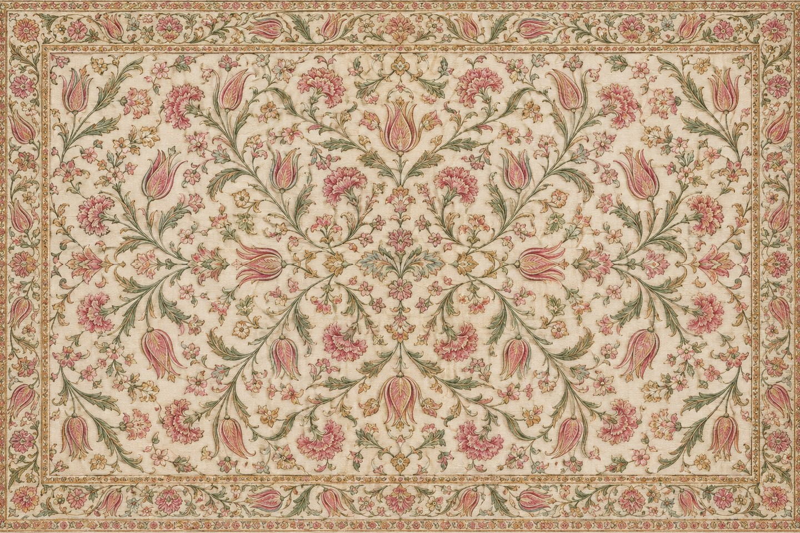

# Kilim

**Sweep your desktop clutter under a Turkish rug.**

Kilim puts a rug on your Windows desktop. Drop files and folders on it and they slip underneath. Lift a corner to see what is under there, take things out, and lay the rug back down.



[Türkçe](#türkçe)

## Download

Get **Kilim-win-x64.exe** from the [latest release](https://github.com/ibrahimsancar/kilim/releases/latest) (or **Kilim-win-arm64.exe** for ARM PCs) and run it. Nothing to install, no .NET needed. Windows 10 or 11.

The exe is not code-signed yet, so the first time Windows may show "Windows protected your PC". Click **More info**, then **Run anyway**. You can check that the file is exactly what was built from this code, see [Verify a download](#verify-a-download).

## Using it

- **Hide something:** drag a file or folder from the desktop onto the rug. It goes under the rug at the spot where you let go.
- **Look underneath:** grab a corner and pull. Pull far enough and it stays up; grab the folded part to fold it further or lay it back. Esc lays it down too.
- **Take something out:** with a corner up, drag an item back to the desktop or into any folder, or right-click it for **Move back out** to return it where it came from.
- **Move the rug:** drag it by the middle.
- **Resize:** drag one of its edges. The rug keeps its shape so the pattern never stretches.
- **Change the pattern:** right-click the rug, **Pattern**.

Things under the rug behave like they do on the desktop: same icons and thumbnails, double-click to open, the same drag and drop.

## Patterns

| Plain | Ushak | Anatolian kilim | Hereke silk |
| --- | --- | --- | --- |
|  |  |  |  |

Calm undyed wool with a single *elibelinde* motif; a classic Ushak medallion carpet; a flat-woven kilim with *elibelinde* and ram's horn rows; and a fine Hereke silk carpet with tulips and carnations. More are welcome, see [Contributing](CONTRIBUTING.md).

## Where your files go

Hidden items are ordinary files in a hidden folder, `%USERPROFILE%\Kilim\items`. Kilim itself never deletes anything: it moves files with Windows' own move, the same one Explorer uses. When you drag an item back out, Windows handles the drop exactly as in Explorer (dropping it on the Recycle Bin deletes it, as it would anywhere). If Kilim is closed or removed, everything is still in that folder, and right-click on the rug, **Show hidden folder** opens it.

## Privacy and safety

- Kilim has no network code: no telemetry, no update check, no accounts. It refuses files on network locations, also behind a local link, and checks links on the local disk first, so hiding something never reaches out to a server.
- It needs no administrator rights and does not start with Windows on its own.
- It keeps its own data only in `%USERPROFILE%\Kilim`, and touches other folders only to move your items in and out when you drag or restore them.
- It refuses to hide a whole drive, its own folder or a folder that contains it, or anything in the Recycle Bin, also when a junction or link points there. When it moves a file it never overwrites one: a name that is already taken gets " (2)".
- It has no third-party packages, only .NET from Microsoft.

The checks behind these promises run on every change, see [tests/SafetyTests](tests/SafetyTests). To report a security problem, see [SECURITY.md](SECURITY.md).

## Verify a download

Every release is built by GitHub Actions from the tagged source, never on a personal computer. Next to the files is `SHA256SUMS.txt`:

```powershell
Get-FileHash .\Kilim-win-x64.exe -Algorithm SHA256
```

The hash must match the line in `SHA256SUMS.txt`. Each exe also carries a signed build provenance record. With the [GitHub CLI](https://cli.github.com/):

```powershell
gh attestation verify .\Kilim-win-x64.exe --repo ibrahimsancar/kilim
```

## Build from source

You need the [.NET 8 SDK](https://dotnet.microsoft.com/download/dotnet/8.0).

```powershell
dotnet run --project src/Kilim
dotnet run --project tests/SafetyTests
dotnet publish src/Kilim -c Release -r win-x64 -o out
```

## License

[MIT](LICENSE). The rug patterns were generated for this project with an image model and are under the same license.

---

## Türkçe

**Masaüstündeki dağınıklığı bir Türk halısının altına süpürün.**

Kilim, Windows masaüstünüze bir halı koyar. Dosya ve klasörleri üstüne bırakın, altına girsinler. Bir köşesini kaldırıp altına bakın, istediğinizi çıkarın, halıyı geri yatırın.

### İndirme

[Son sürümden](https://github.com/ibrahimsancar/kilim/releases/latest) **Kilim-win-x64.exe** dosyasını indirip çalıştırın (ARM işlemcili bilgisayarlar için **Kilim-win-arm64.exe**). Kurulum ya da .NET gerekmez. Windows 10 veya 11.

Program henüz dijital olarak imzalı değil; ilk açılışta Windows "Windows kişisel bilgisayarınızı korudu" uyarısı gösterebilir. **Ek bilgi**, ardından **Yine de çalıştır**'a tıklayın. İndirdiğiniz dosyanın bu koddan üretildiğini [indirmeyi doğrulama](#verify-a-download) adımlarıyla kontrol edebilirsiniz.

### Kullanım

- **Saklamak:** Masaüstünden bir dosya ya da klasörü halının üstüne sürükleyin. Bıraktığınız noktada halının altına girer.
- **Altına bakmak:** Bir köşeden tutup çekin. Yeterince çekerseniz kalkık kalır; katlanan kısmı tutup daha çok katlayabilir ya da geri yatırabilirsiniz. Esc de halıyı indirir.
- **Çıkarmak:** Köşe kalkıkken bir dosyayı masaüstüne ya da bir klasöre sürükleyin, ya da sağ tıklayıp **Geri çıkar** ile geldiği yere gönderin.
- **Taşımak:** Halıyı ortasından tutup sürükleyin.
- **Boyut:** Bir kenarından çekin. Desen bozulmasın diye halının oranı korunur.
- **Desen:** Halıya sağ tıklayın, **Desen**.

Halının altındakiler masaüstündeki gibi davranır: aynı simgeler ve önizlemeler, çift tıklayınca açılır, aynı sürükle-bırak.

### Dosyalarınız nerede

Saklananlar gizli bir klasörde, `%USERPROFILE%\Kilim\items` içinde, sıradan dosyalar olarak durur. Kilim kendisi hiçbir şeyi silmez; dosyaları Windows'un kendi taşıma işlemiyle taşır. Bir dosyayı halının altından dışarı sürüklediğinizde bırakmayı Windows, Explorer'daki gibi yapar (Geri Dönüşüm Kutusu'na bırakırsanız silinir). Kilim kapalı ya da kaldırılmış olsa bile her şey o klasördedir. Halıya sağ tıklayıp **Saklanan klasörü göster** ile açabilirsiniz.

### Gizlilik ve güvenlik

- İnternete bağlanan hiçbir kodu yoktur; veri toplamaz, güncelleme denetimi ya da hesap yoktur. Ağdaki dosyaları, yerel bir bağlantının ardında olsalar bile kabul etmez ve bağlantıları önce yerel diskte denetler; böylece bir şeyi saklamak hiçbir sunucuya bağlanmaz.
- Yönetici izni istemez, Windows açılınca kendiliğinden başlamaz.
- Kendi verisini yalnızca `%USERPROFILE%\Kilim` klasöründe tutar; başka klasörlere ancak siz bir dosyayı sokup çıkarırken dokunur.
- Bir sürücünün tamamını, kendi klasörünü ya da onu içeren bir klasörü, Geri Dönüşüm Kutusu'ndakileri saklamaz; bir kısayol klasörü (junction) oraya yönlendirse bile. Bir dosyayı taşırken hiçbir dosyanın üzerine yazmaz; aynı ad varsa sonuna " (2)" eklenir.
- Dışarıdan hiçbir hazır kod paketi kullanmaz; yalnızca Microsoft'un .NET'i.

Lisans: [MIT](LICENSE).
